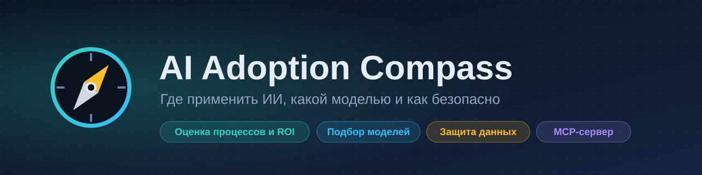
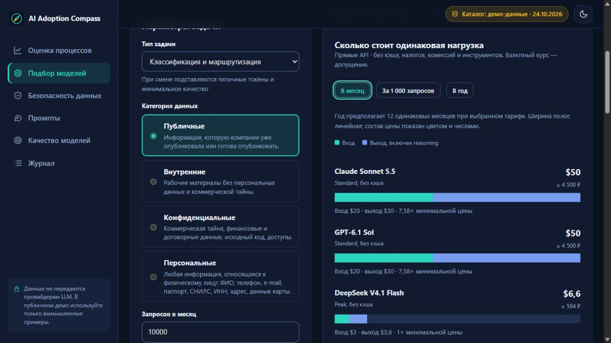
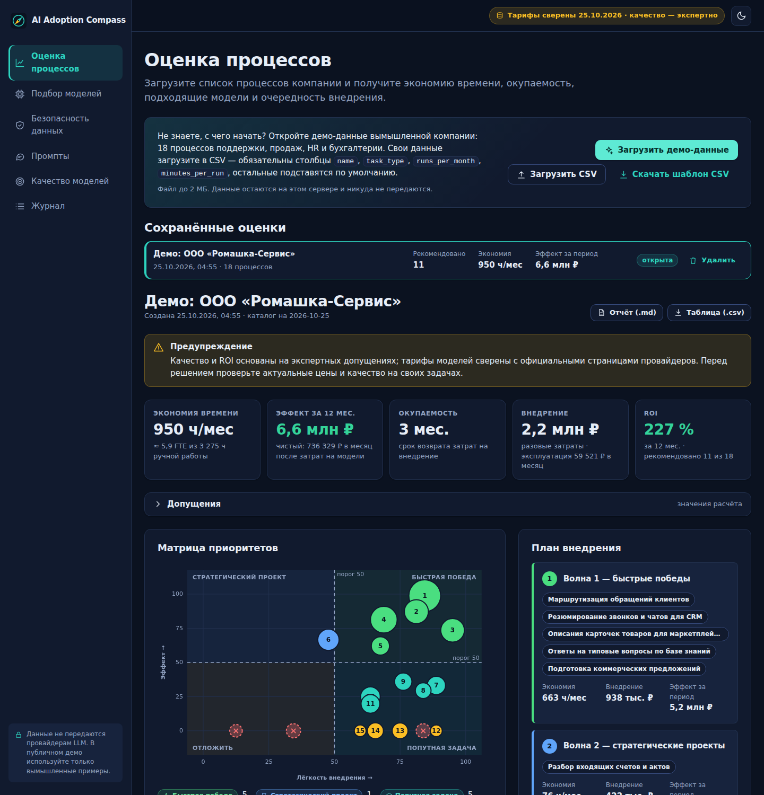
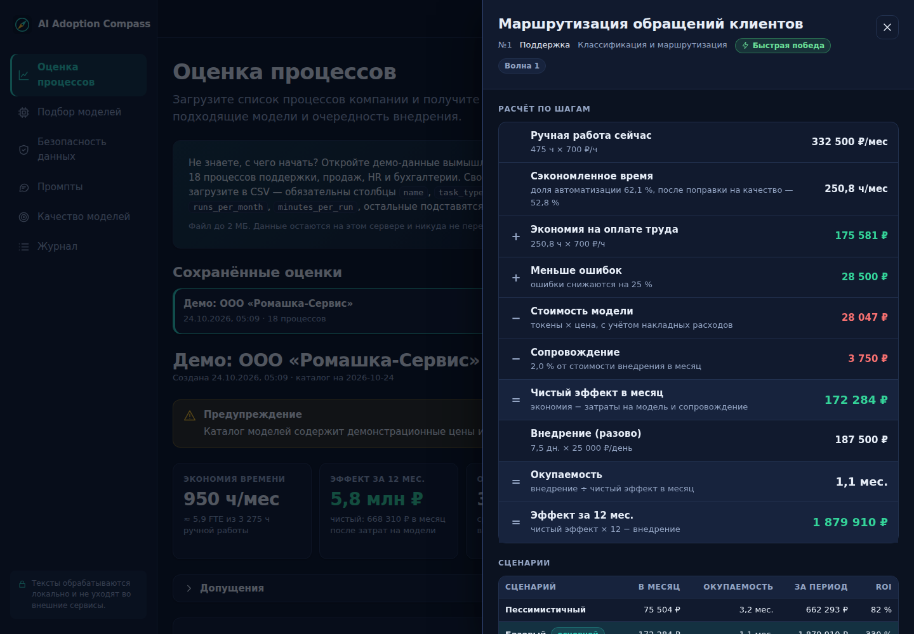
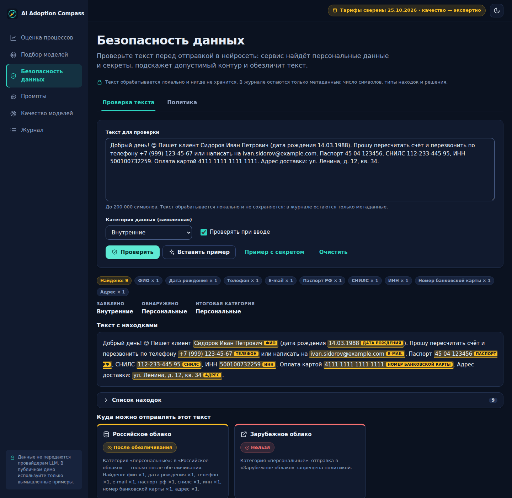
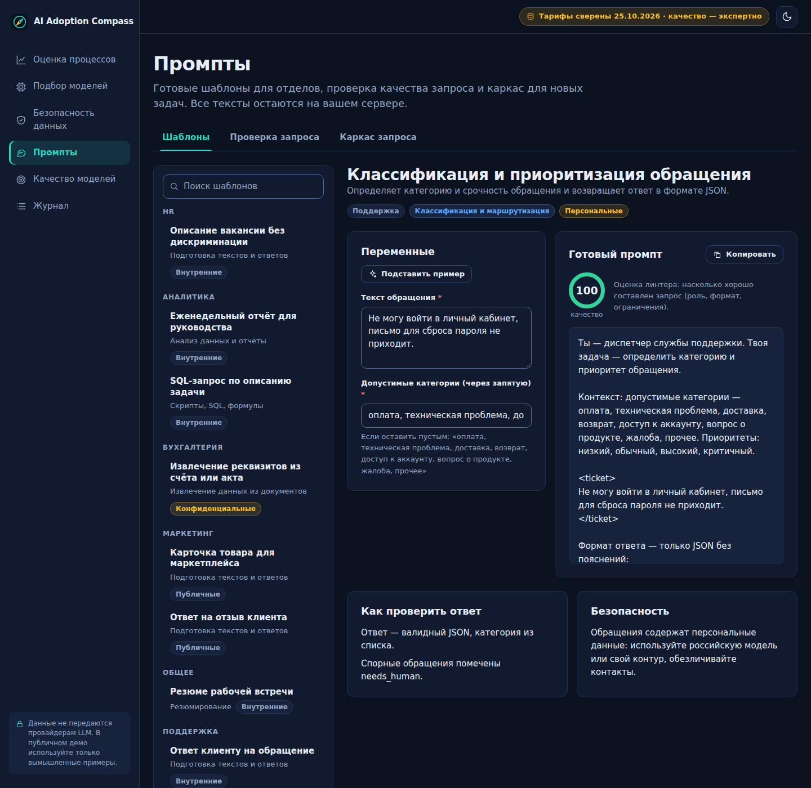
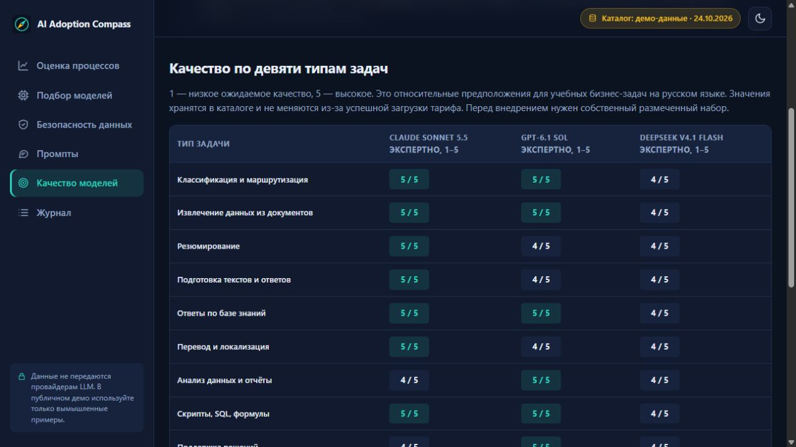
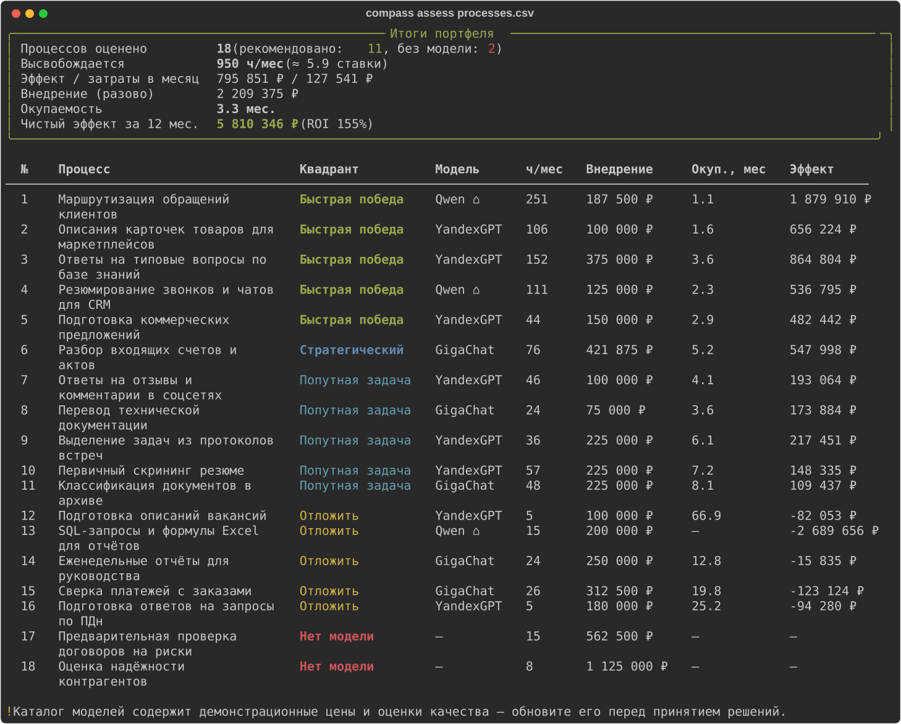

<p align="center">
  
</p>

<p align="center">
  <a href="https://github.com/RainCherb/ai-adoption-compass/actions/workflows/ci.yml"></a>
  
  
  
  
  
  <a href="LICENSE"></a>
</p>

<p align="center"><a href="README.md">Русский</a> · <b>English</b></p>

# AI Adoption Compass

**A practical toolkit for rolling out AI in a company.** Find the processes where a neural network pays off, pick a model
for the task, the budget and the data-residency constraints of the Russian market, keep personal data out of prompts, and
teach employees to use AI safely. Everything is computed transparently, covered by tests, and reachable through a web
dashboard, a CLI, a REST API and an MCP server for coding agents.

> The product UI, templates, policy and documentation are in Russian (the target audience is Russian-speaking
> companies); code identifiers and API fields are in English. The methodology itself is language-independent.

## Integrated international models

The model advisor and all 18 public demo processes use **Claude Sonnet 5.5 → GPT-6.1 Sol → DeepSeek V4.1 Flash**. Compare direct API costs on the same workload, with DeepSeek peak/off-peak and GPT long-context pricing. Provider facts and limits are linked to official sources, pinned to reviewed snapshots and hidden from cost calculations after expiry. The same tariffs drive ROI, sensitivity scenarios and exports. Quality ratings are explicit expert assumptions; these three models have not been evaluated in this project. [Method and checked numbers](docs/FEATURED_MODELS.md).



## New in 1.4

**[Try the public demo →](https://ai-adoption-compass-demo.onrender.com)** ·
[API model quality](https://ai-adoption-compass-demo.onrender.com/#/evals)

No installation or account needed. Render Free may take about a minute to wake up after being idle. Use synthetic data only.

* A public demo mode with a preloaded 18-process assessment, what-if calculations and no shared visitor data storage.
  Docker deployment on Render Free is described in [public demo operations](docs/PUBLIC_DEMO.md).
* API-only model selection: input/output budget charts, monthly / 1,000 requests / annual estimates, and cumulative cashflow with a month slider. [Numbers and limitations](docs/API_COST_ANALYTICS.md).
* Explicit Russian API availability, a shared expert quality matrix and an API pilot plan. Previous local measurements remain an [archived study](docs/REAL_EVALS.md), outside the product comparison.
* Managed pricing/access sources with dated snapshots, SHA-256, expiry, manual review and a weekly review artifact.
  [Source governance](docs/CATALOG_SOURCES.md) keeps aggregator offers separate from illustrative expert scores.

## What it answers

| Question | What the toolkit does |
| --- | --- |
| **Where** will AI pay off? | Scores processes: AI fit, hours and money saved, payback in three scenarios, priorities and a rollout roadmap |
| **Which** model? | Hard constraints (data policy, access from Russia, budget, capabilities) plus an explanation of why every other model was excluded |
| **How** do we keep data safe? | Detects personal data and secrets, reversible masking, one policy "data class → model deployment", a CI gate |
| **What** do we teach people? | 12 ready prompt templates, a prompt linter, an employee handout and a workshop plan |

## Features

| Module | Description | Available via |
| --- | --- | --- |
| **Process scoring and ROI** | Fit, time saved, payback (pessimistic / base / optimistic), impact×ease matrix, rollout waves, external API costs | Dashboard · `compass assess` · API · MCP |
| **Model advisor** | Filters by data policy, Russia access, quality, budget; 4 ranking profiles; "what to relax" hints | Dashboard · `compass advise` · API · MCP |
| **Data safety** | Names, phones, e-mails, INN, SNILS, cards, passports, addresses, keys and passwords — checksum-validated; `[PHONE_1]` placeholders with reversible unmasking | Dashboard · `compass scan` / `mask` · API · MCP |
| **Prompts** | 12 department templates, sandboxed rendering, 0–100 linter, prompt scaffold | Dashboard · `compass prompt` · API · MCP |
| **Model evaluation** | Run models on your labeled data: accuracy, F1, latency, cost, lift over a rules baseline; any OpenAI-compatible API | Dashboard · `compass eval` |
| **Training** | Employee handout generated from the policy; [workshop plan](docs/training/workshop-plan.md); [rollout playbook](docs/ROLLOUT_PLAYBOOK.md) | `compass policy handout` · `docs/` |

## Screenshots

<table>
  <tr>
    <td width="50%"><br><sub>Portfolio KPIs, impact×ease matrix and ranking</sub></td>
    <td width="50%"><br><sub>Process breakdown: hours → money → payback, three scenarios</sub></td>
  </tr>
  <tr>
    <td><br><sub>Explainable model ranking and exclusion reasons</sub></td>
    <td><br><sub>Highlighted findings, a decision per deployment, masking</sub></td>
  </tr>
  <tr>
    <td><br><sub>Templates by department, quality score, answer-check checklist</sub></td>
    <td><br><sub>Shared expert quality matrix; measured benchmarks available separately</sub></td>
  </tr>
</table>

## Quick start

```bash
git clone https://github.com/RainCherb/ai-adoption-compass && cd ai-adoption-compass
make install      # Python 3.11+, virtualenv and dependencies
make web          # build the UI (Node 24.15+)
make run          # http://127.0.0.1:8000
```

<details>
<summary>Windows / PowerShell — run without Make</summary>

Requires Python 3.11+ and Node.js 24.15+.

```powershell
git clone https://github.com/RainCherb/ai-adoption-compass
cd ai-adoption-compass
python -m venv .venv
.\.venv\Scripts\python.exe -m pip install -e ".[dev]"
npm --prefix web ci
npm --prefix web run build
.\.venv\Scripts\compass.exe serve
```

Open `http://127.0.0.1:8000`. No virtualenv activation is needed.

</details>

CLI only (no Node needed):

```bash
pip install -e .
compass demo
compass assess src/adoption_compass/data/samples/processes.csv
```

Docker (the port is published on localhost only): `docker compose up --build`.

## Highlights

**Process scoring.** Describe processes in a CSV (Excel-friendly: `;`, cp1251, decimal comma, Russian headers are accepted).

```bash
compass assess processes.csv                       # table in the terminal
compass assess processes.csv -f md -o report.md    # report for management
```

<p align="center"></p>

**Data gate for CI.** Exit code `2` means sending the text to the chosen deployment violates the policy.

```bash
echo "Client Ivan Ivanovich, tel. +7 912 345-67-89" | compass scan - --target foreign_cloud
compass mask letter.txt -o letter.masked.txt --mapping mapping.json   # [PERSON_1], [PHONE_1]
```

**MCP for coding agents** (Claude Code, Codex, OpenCode, Kiro). File tools work inside an allowed root and return
metadata only — raw personal data never enters the model context.

```bash
claude mcp add --transport stdio --scope project compass -- compass mcp --root .
codex mcp add compass -- compass mcp --root .
```

See [docs/MCP.md](docs/MCP.md) for all four clients and the tool reference.

**REST API.** Interactive docs at `/api/docs`; the contract lives in [docs/openapi.json](docs/openapi.json).

## Design principles

* **Data as code** — prices, ratings, policy, assumptions and templates live in schema-validated YAML
  (`compass data export` copies them for customization).
* **Explainability** — every recommendation shows score components, pros and cons; every exclusion lists its reasons.
* **Privacy by construction** — the API never calls external LLMs; raw texts are not stored; findings are shown as masked previews.
* **Determinism** — the same input always yields the same output, so reports and screenshots are reproducible.

Docs: [architecture](docs/ARCHITECTURE.md) · [methodology (formulas, worked example)](docs/METHODOLOGY.md) ·
[requirements & traceability](docs/REQUIREMENTS.md) · [rollout playbook](docs/ROLLOUT_PLAYBOOK.md).

## Honest limitations

* The **model catalog is illustrative**: prices, quality ratings and Russia-access status are starting values flagged
  in the UI, CLI and reports. Verify tariffs with providers; `compass catalog check` and a monthly workflow remind you.
* Quality ratings (1–5) are expert estimates — replace them with `compass eval` results on your data. The `sim:*` profiles
  in the evaluation harness are a deterministic simulation, not real models.
* PII detectors are rules and heuristics, not a substitute for security processes or legal review.
* The app has **no authentication** and is meant for local or internal use — see [SECURITY.md](SECURITY.md).
* ROI is an estimate based on assumptions, not a guarantee.

## Engineering quality

* 500+ tests: backend (unit, property-based with Hypothesis, API, CLI, the MCP server in a real stdio process) and frontend (Vitest + Testing Library: pages, components, hooks).
* Docs-as-tests: the OpenAPI snapshot, the employee handout, the methodology example, doc links and documented CLI commands are verified.
* `mypy --strict`, `ruff`, TypeScript strict with types generated from OpenAPI.
* GitHub Actions: Python 3.11/3.12, frontend, `actionlint`, `hadolint`, Docker build with a health check.
* Frontend structure and design decisions: [web/README.md](web/README.md) (in Russian).

```bash
make check     # lint + mypy + pytest (coverage ≥ 85%) + OpenAPI check + frontend checks
```

## How it was built

Designed and implemented with an AI agent from the author's brief: requirements and acceptance criteria are written down in
[docs/REQUIREMENTS.md](docs/REQUIREMENTS.md), decisions in [docs/ARCHITECTURE.md](docs/ARCHITECTURE.md), and the result is verified by
automated tests and CI. The repository ships [AGENTS.md](AGENTS.md) so coding agents can continue the work under the same rules.

## License

[MIT](LICENSE) © 2026 RainCherb
