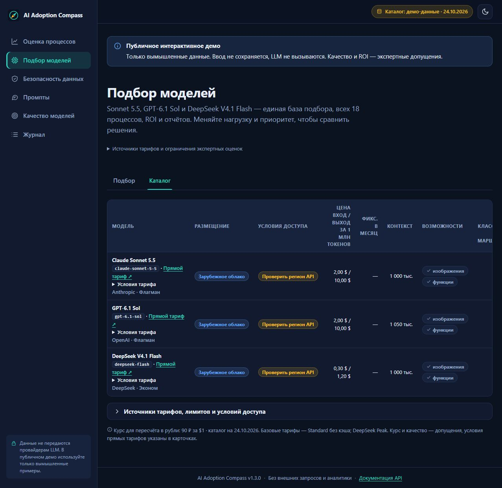
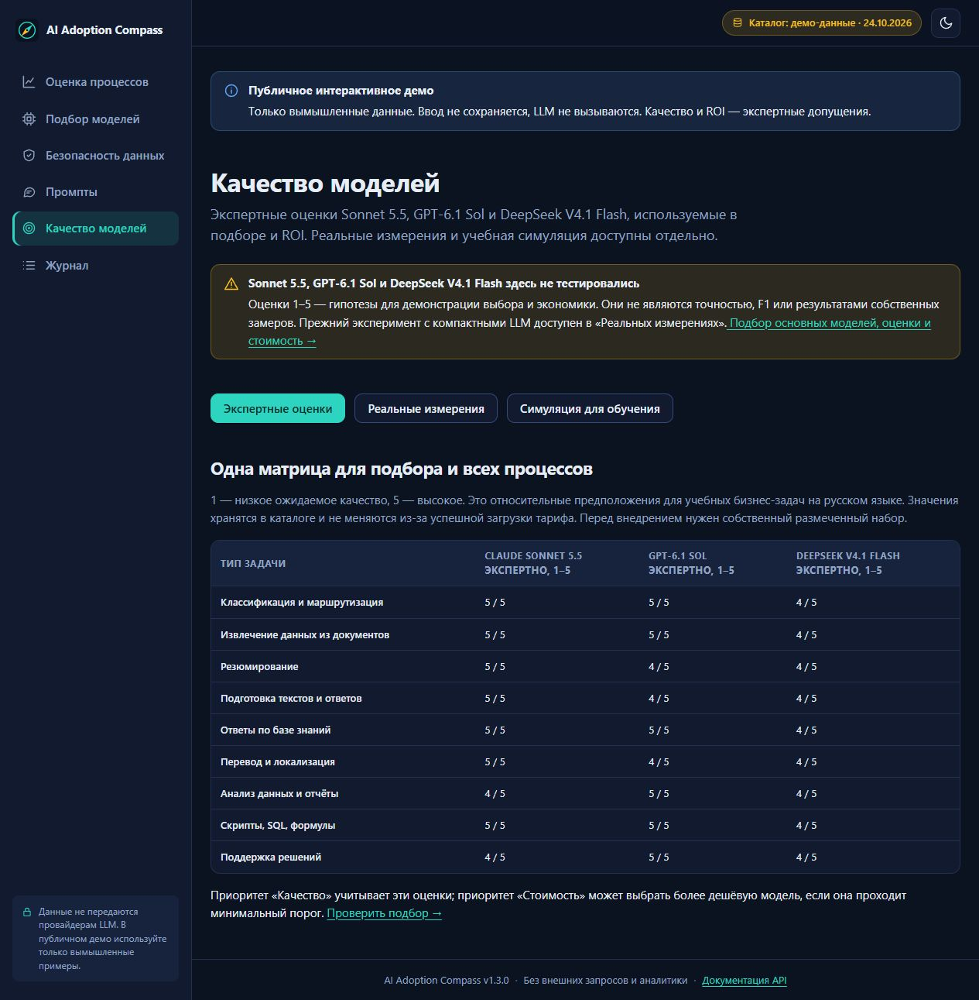
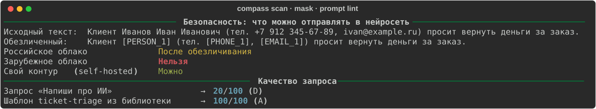
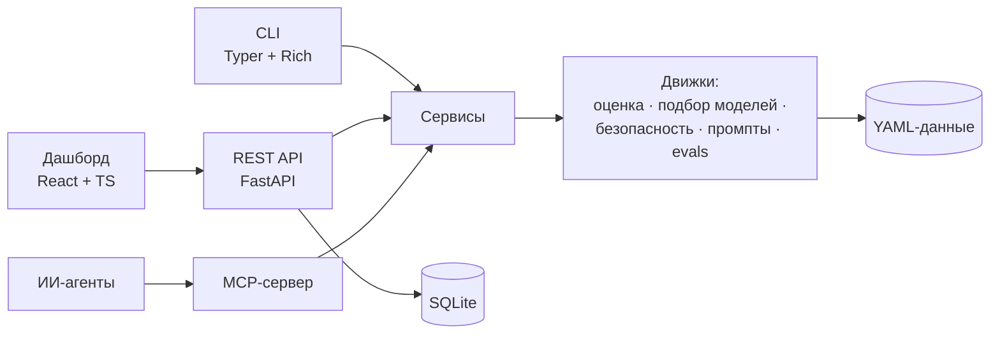

<p align="center">
  
</p>

<p align="center">
  <a href="https://github.com/RainCherb/ai-adoption-compass/actions/workflows/ci.yml"></a>
  
  
  
  
  
  <a href="LICENSE"></a>
</p>

<p align="center"><b>Русский</b> · <a href="README.en.md">English</a></p>

# AI Adoption Compass

**Компас внедрения ИИ в компании.** Инструменты, с которых начинается практическая работа специалиста по внедрению ИИ:
найти процессы, где нейросеть окупится, сравнить зарубежные модели, подобрать решение под задачу, бюджет и ограничения данных, не допустить утечки
данных и научить сотрудников работать с ИИ безопасно. Всё считается прозрачно, проверяется тестами и подключается к
рабочим инструментам — через веб-интерфейс, командную строку, REST API и MCP.

## Новое в 1.3

**[Попробовать интерактивное демо →](https://ai-adoption-compass-demo.onrender.com)** ·
[Реальные измерения LLM](https://ai-adoption-compass-demo.onrender.com/#/evals)

Без установки и регистрации. На Render Free первое открытие после простоя может занять около минуты.
Используйте только вымышленные данные.

* **Единая база подбора и экономики демо:** Claude Sonnet 5.5 → GPT-6.1 Sol → DeepSeek V4.1 Flash. Модели встроены в подбор, все 18 процессов, ROI, сценарии и отчёты. Прямые тарифы, экспертные оценки, Peak/Off-peak и порог длинного контекста GPT. [Числа, первоисточники и ограничения](docs/FEATURED_MODELS.md). Собственные замеры качества этих трёх моделей пока отсутствуют.
* **Публичное интерактивное демо:** готовая оценка 18 процессов, пересчёт сценариев, подбор моделей, безопасность и промпты.
  Посетителю не нужны Python, Node.js или API-ключ. Для хостинга предусмотрен отдельный режим без сохранения пользовательских данных — [устройство и развёртывание](docs/PUBLIC_DEMO.md).
* **Настоящие LLM:** Qwen2.5-0.5B, Qwen3-0.6B и SmolLM2-360M проверены на одном наборе из 72 обращений без платных API.
  Правила оказались лучше каждой из них; [результаты, ограничения и воспроизведение](docs/REAL_EVALS.md) опубликованы вместе с полными ответами.
* **Управляемые источники:** датированные снимки тарифов конкретных моделей, хеши, срок актуальности и ручное ревью условий
  доступа — [процесс обновления](docs/CATALOG_SOURCES.md). Экспертный каталог и цены агрегатора не смешиваются.



## Зачем это нужно

Компании внедряют ИИ хаотично: берутся за модные, а не выгодные задачи, переплачивают за модели, вставляют в чат клиентские
данные и договоры, а сотрудников оставляют один на один с чат-ботом. Compass отвечает на четыре вопроса:

| Вопрос | Ответ инструмента |
| --- | --- |
| **Где** ИИ даст эффект? | Скоринг процессов: пригодность для ИИ, часы и деньги, окупаемость в трёх сценариях, приоритеты и дорожная карта |
| **Какой** моделью? | Подбор с жёсткими ограничениями (политика данных, доступность из РФ, бюджет, возможности) и объяснением, почему остальные не подошли |
| **Как** не утекут данные? | Поиск ПДн и секретов, обратимое обезличивание, единая политика «данные → размещение модели», гейт для CI |
| **Чему** учить людей? | 12 готовых шаблонов запросов, линтер качества промптов, памятка и план тренинга |

## Возможности

| Модуль | Что делает | Где доступен |
| --- | --- | --- |
| **Оценка процессов и ROI** | Пригодность, экономия времени, окупаемость (пессимистичный / базовый / оптимистичный сценарии), матрица «эффект — простота», волны внедрения, общий self-hosted сервер | Дашборд · `compass assess` · API · MCP |
| **Подбор моделей** | Фильтры по политике данных, доступу из РФ, качеству, бюджету; ранжирование по 4 профилям; подсказки «что ослабить» | Дашборд · `compass advise` · API · MCP |
| **Безопасность данных** | ФИО, телефоны, e-mail, ИНН, СНИЛС, карты, паспорта, адреса, ключи и пароли — с проверкой контрольных сумм; метки `[PHONE_1]` и обратная подстановка | Дашборд · `compass scan` / `mask` · API · MCP |
| **Промпты** | Библиотека из 12 шаблонов по отделам, песочница рендеринга, линтер 0–100, каркас запроса | Дашборд · `compass prompt` · API · MCP |
| **Качество моделей** | Прогон на ваших размеченных данных: точность, F1, задержки, стоимость, прирост к baseline; любой OpenAI-совместимый API | Дашборд · `compass eval` |
| **Обучение** | Памятка для сотрудников, генерируемая из политики; [план тренинга](docs/training/workshop-plan.md); [плейбук внедрения](docs/ROLLOUT_PLAYBOOK.md) | `compass policy handout` · `docs/` |

## Интерфейс

Тёмная и светлая темы, русский интерфейс, никаких внешних запросов: шрифты, графики и иконки — локальные.

<table>
  <tr>
    <td width="50%"><br><sub><b>Оценка процессов:</b> KPI портфеля, матрица «эффект — простота» и рейтинг</sub></td>
    <td width="50%"><br><sub><b>Карточка процесса:</b> от часов до окупаемости, три сценария, предупреждения</sub></td>
  </tr>
  <tr>
    <td><br><sub><b>Подбор моделей:</b> оценка по четырём компонентам, плюсы и минусы, причины исключения</sub></td>
    <td><br><sub><b>Безопасность:</b> находки в тексте, решение по каждому размещению, обезличивание</sub></td>
  </tr>
  <tr>
    <td><br><sub><b>Промпты:</b> шаблоны по отделам, оценка качества, чек-лист проверки ответа</sub></td>
    <td><br><sub><b>Качество моделей:</b> сравнение с baseline по точности, задержке и стоимости</sub></td>
  </tr>
</table>

## Быстрый старт

```bash
git clone https://github.com/RainCherb/ai-adoption-compass && cd ai-adoption-compass
make install      # Python 3.11+, виртуальное окружение и зависимости
make web          # сборка интерфейса (Node 24.15+)
make run          # http://127.0.0.1:8000
```

<details>
<summary>Windows / PowerShell — запуск без Make</summary>

Нужны Python 3.11+ и Node.js 24.15+.

```powershell
git clone https://github.com/RainCherb/ai-adoption-compass
cd ai-adoption-compass
python -m venv .venv
.\.venv\Scripts\python.exe -m pip install -e ".[dev]"
npm --prefix web ci
npm --prefix web run build
.\.venv\Scripts\compass.exe serve
```

Откройте `http://127.0.0.1:8000`. Активация окружения не требуется.

</details>

Только командная строка, без Node:

```bash
pip install -e .
compass demo                                   # все возможности на демо-данных
compass assess src/adoption_compass/data/samples/processes.csv
```

Docker (порт публикуется только на localhost):

```bash
docker compose up --build        # http://127.0.0.1:8000
```

## От CSV до дорожной карты

Опишите процессы в таблице — Excel сохраняет её как есть: поддерживаются `;`, кодировка cp1251, десятичная запятая и
русские заголовки. Нужны четыре колонки: `name`, `task_type`, `runs_per_month`, `minutes_per_run`; остальные уточняют расчёт.

```bash
compass assess processes.csv              # таблица в терминале
compass assess processes.csv -f md -o report.md   # отчёт для руководителя
```

<p align="center"></p>

Демо-портфель — вымышленная «ООО «Ромашка-Сервис»» из 18 процессов: поддержка, продажи, бухгалтерия, HR, юристы, маркетинг,
ИТ, закупки. Пять процессов оказываются «быстрыми победами», два блокируются политикой данных (юридический анализ договоров и
оценка контрагентов требуют качества, которого нет у допустимых моделей), а процесс «SQL и формулы» показывает, как
включение обходных путей доступа меняет решение: вместо GPU-сервера за 220 тыс. ₽/мес — облачная модель.
Как считаются цифры — в [методологии](docs/METHODOLOGY.md).

## Данные под защитой

```bash
echo "Клиент Иванов Иван Иванович, тел. +7 912 345-67-89" | compass scan - --target foreign_cloud
# → код возврата 2: персональные данные нельзя отправлять в зарубежное облако

compass mask письмо.txt -o письмо.masked.txt --mapping соответствия.json   # [PERSON_1], [PHONE_1]
compass unmask ответ_модели.txt --mapping соответствия.json                  # вернуть значения
```

<p align="center"></p>

* Решение зависит от **единой политики** (`policy.yaml`): матрица «категория данных × размещение модели» управляет
  советником, оценкой процессов, проверкой текстов и памяткой для сотрудников.
* Код возврата `compass scan` удобно использовать как **гейт в CI**:

  ```yaml
  - run: |
      for f in $(git ls-files 'prompts/*.txt'); do
        compass scan "$f" --target foreign_cloud --fail-on mask
      done
  ```

* Журнал и ответы API хранят только метаданные; находки показываются как маскированные превью.

## Подключение к ИИ-агентам (MCP)

`compass mcp` — MCP-сервер из десяти инструментов для **Claude Code, Codex, OpenCode и Kiro**. Файловые инструменты работают
внутри разрешённой папки и возвращают агенту только метаданные: сырые персональные данные в контекст модели не попадают.

```bash
claude mcp add --transport stdio --scope project compass -- compass mcp --root .   # Claude Code
codex mcp add compass -- compass mcp --root .                                       # Codex CLI
```

Конфигурации для OpenCode и Kiro и описание инструментов — в [docs/MCP.md](docs/MCP.md).

## REST API

```bash
curl -s localhost:8000/api/advice -H 'content-type: application/json' -d '{
  "task_type": "classification", "data_sensitivity": "personal",
  "requests_per_month": 20000, "tokens_in": 700, "tokens_out": 60
}' | jq '.recommendations[] | {rank, name, score, cost: .cost.total_rub}'
```

Интерактивная документация — `http://127.0.0.1:8000/api/docs`; контракт — [docs/openapi.json](docs/openapi.json).

## Как это устроено



* **Данные как код:** цены, оценки, политика, допущения и шаблоны — в YAML с проверкой схем; `compass data export` копирует их
  для настройки под вашу компанию.
* **Объяснимость:** у каждой рекомендации есть разбор оценки, плюсы и минусы, у каждого исключения — причины.
* **Приватность по построению:** API не обращается к внешним LLM, исходные тексты не сохраняются.
* **Детерминированность:** одинаковый вход даёт одинаковый результат — отчёты и скриншоты воспроизводимы.

Подробнее: [архитектура](docs/ARCHITECTURE.md) · [методология](docs/METHODOLOGY.md) · [требования и трассировка](docs/REQUIREMENTS.md).

## Честные ограничения

* **Каталог моделей — демонстрационный.** Цены, оценки качества и статус доступности из РФ — стартовые значения
  (`data_status: illustrative`), помеченные в интерфейсе, CLI и отчётах. Перед решениями сверяйте тарифы с провайдерами;
  `compass catalog check` и ежемесячный workflow напоминают об этом.
* **Оценки качества моделей (1–5) — экспертные.** Правильный путь — заменить их результатами `compass eval` на ваших данных.
  Профили `sim:*` в харнессе — детерминированный симулятор для демонстрации, а не реальные модели.
* **Детекторы — правила и эвристики**, они снижают риск, но не заменяют процессы ИБ и юридическую оценку (152-ФЗ и др.).
* **Приложение без аутентификации** рассчитано на локальный запуск и внутренний контур — см. [SECURITY.md](SECURITY.md).
* Расчёт ROI — оценка на основе допущений, а не гарантия результата.

## Качество

| Что | Как |
| --- | --- |
| Тесты | более 500 тестов: бэкенд (юнит, property-based на Hypothesis, API, CLI, MCP в реальном stdio-процессе) и фронтенд (Vitest + Testing Library: страницы, компоненты, хуки) |
| Документация как код | схема OpenAPI, памятка, пример из методологии, ссылки и CLI-команды в документах проверяются тестами |
| Типы и стиль | `mypy --strict`, `ruff`; интерфейс — TypeScript strict, типы генерируются из OpenAPI |
| CI | GitHub Actions: Python 3.11 / 3.12, фронтенд, `actionlint`, `hadolint`, сборка Docker-образа и проверка здоровья |
| Безопасность | строгий CSP, защита от path traversal, песочница шаблонов, лимиты на размер данных |

```bash
make check     # линтеры + mypy + pytest (покрытие ≥ 85 %) + проверка OpenAPI + проверки фронтенда
```

## Документация

* [Методология расчёта](docs/METHODOLOGY.md) · [Архитектура](docs/ARCHITECTURE.md) · [Подключение по MCP](docs/MCP.md)
* [Требования и трассировка](docs/REQUIREMENTS.md)
* [Плейбук внедрения ИИ в компании](docs/ROLLOUT_PLAYBOOK.md) · [План тренинга для сотрудников](docs/training/workshop-plan.md) ·
  [Памятка «Безопасная работа с нейросетями»](docs/training/safe-ai-handout.md)
* [Фронтенд](web/README.md) · [AGENTS.md](AGENTS.md) — инструкции для ИИ-агентов · [CONTRIBUTING.md](CONTRIBUTING.md) · [CHANGELOG.md](CHANGELOG.md)

## Дорожная карта

- [ ] Нативные клиенты российских провайдеров (GigaChat, YandexGPT) для `compass eval`
- [ ] Оценка качества для RAG: полнота найденных фрагментов и обоснованность ответов
- [ ] Экспорт отчёта в PDF и Excel
- [ ] Аутентификация и роли для многопользовательского запуска
- [x] Снимки тарифов из проверяемых источников с датой, сроком актуальности и ревью точного хеша

## Как создан проект

Проект спроектирован и реализован с помощью ИИ-агента по техническому заданию автора: требования и критерии приёмки
зафиксированы в [docs/REQUIREMENTS.md](docs/REQUIREMENTS.md), решения — в [docs/ARCHITECTURE.md](docs/ARCHITECTURE.md), а результат
проверяется автотестами и CI. Такой процесс — формулировка требований, разбиение на этапы, ревью и проверка результата —
и есть основа разработки с ИИ-агентами. Репозиторий содержит [AGENTS.md](AGENTS.md), чтобы агенты (Claude Code, Codex, OpenCode,
Kiro) могли продолжать работу по тем же правилам.

## Лицензия

[MIT](LICENSE) © 2026 RainCherb
