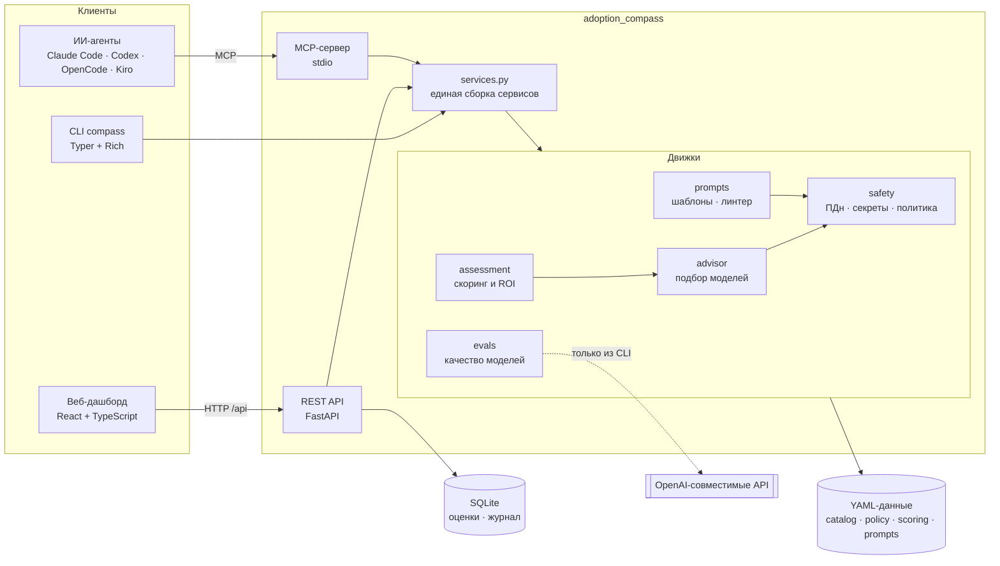

# Архитектура

## Общая схема

## Структура пакета

| Модуль | Ответственность |
| --- | --- |
| `domain.py` | перечисления, русские подписи, разбор значений |
| `config.py`, `resources.py` | настройки из окружения; загрузка встроенных YAML с переопределением из `COMPASS_DATA_DIR` |
| `catalog.py` | схема каталога моделей, проверка полноты и свежести |
| `safety/` | `detectors` (регулярные выражения + контрольные суммы), `masking` (обратимые метки), `policy` (матрица и памятка), `guard` (анализ и решения) |
| `advisor.py` | жёсткие ограничения, расчёт стоимости, объяснимое ранжирование |
| `scoring.py`, `assessment.py` | допущения; пригодность, ROI, сценарии, приоритизация, общая инфраструктура |
| `csv_io.py` | устойчивый разбор CSV (Excel: `;`, cp1251, десятичная запятая) |
| `prompts/` | шаблоны (Jinja2 в песочнице) и линтер качества запросов |
| `evals/` | задача и золотой набор, провайдеры, метрики, отчёты |
| `reports.py` | Markdown-отчёт и CSV |
| `storage.py` | SQLite: сохранённые оценки и журнал метаданных |
| `services.py` | единая точка сборки для API, CLI и MCP |
| `api/`, `cli.py`, `mcp_server.py` | три интерфейса к одним и тем же движкам |

Зависимости направлены строго вниз: интерфейсы → `services` → движки → данные. Движки не знают ни про HTTP,
ни про терминал, поэтому одинаково тестируются и используются из всех интерфейсов.

## Ключевые решения

1. **Данные как код.** Цены, оценки качества, политика, допущения и шаблоны лежат в YAML и проверяются схемами
   Pydantic при загрузке. Компания калибрует инструмент, не трогая Python; ошибка в данных падает при старте, а не в расчёте.
2. **Объяснимость вместо «чёрного ящика».** Каждая рекомендация сопровождается компонентами оценки, плюсами и минусами,
   а каждое исключение — списком причин. Если вариантов нет, советник говорит, *что* ослабить (кроме политики данных).
3. **Приватность по построению.**
   * журнал и API-ответы не содержат исходных текстов — только метаданные, а находки показываются как маскированные превью;
   * сырые значения хранятся в памяти только на время запроса и исключены из `repr`;
   * файловые инструменты MCP работают внутри разрешённой папки и возвращают агенту лишь метаданные;
   * API **никогда** не делает исходящих вызовов к LLM; к внешним моделям обращается только CLI (`compass eval run -p api`).
4. **Детерминированность.** Скоринг, ранжирование и симулятор моделей не используют случайность без фиксированного
   зерна, поэтому тесты, отчёты и скриншоты воспроизводимы.
5. **SQLite без ORM.** Короткие соединения на операцию, WAL, версионирование схемы через `PRAGMA user_version`.
   Для локального инструмента этого достаточно, а зависимостей меньше.
6. **Единый контракт API.** `docs/openapi.json` генерируется из кода и проверяется в CI; из него получаются
   TypeScript-типы фронтенда, поэтому рассинхрон схемы ловится сборкой.

## Модель угроз (кратко)

| Угроза | Мера |
| --- | --- |
| Утечка ПДн и секретов в промпты | детекторы с проверкой контрольных сумм, политика «данные → размещение», обезличивание, гейт `compass scan` (код 2) для CI и pre-commit |
| Утечка через журнал, логи и API | журнал хранит только метаданные; превью необратимо скрывают значение; тесты проверяют отсутствие исходников в ответах |
| Выход агента за пределы файловой системы | MCP-инструменты разрешают пути только внутри `COMPASS_MCP_ROOT`; учитываются `..`, абсолютные пути и симлинки |
| Path traversal при раздаче фронтенда | путь разрешается и проверяется на принадлежность каталогу сборки |
| Инъекции в шаблоны | Jinja2 `SandboxedEnvironment` + `StrictUndefined`; значения полей не интерпретируются как шаблон |
| Тяжёлые запросы | лимиты длины текста, размера файла и числа строк CSV |
| XSS и сторонние запросы | строгий CSP (`default-src 'self'`), без CDN и шрифтов с внешних доменов, `X-Frame-Options: DENY` |

**Важное допущение.** Приложение рассчитано на локальный запуск или внутренний контур и **не содержит аутентификации**.
Не публикуйте порт в интернет: ставьте reverse proxy с авторизацией. В `docker-compose.yml` порт привязан к `127.0.0.1`.

## Стратегия тестирования

| Уровень | Что проверяется | Инструменты |
| --- | --- | --- |
| Юнит | формулы с ручным расчётом, контрольные суммы, метрики, парсеры | pytest |
| Свойства | инварианты для произвольных входных данных: `unmask(mask(x)) == x`, границы оценок, непересекающиеся находки | Hypothesis |
| Интеграция | все эндпоинты API, CLI с кодами возврата, OpenAI-совместимый клиент на `httpx.MockTransport` | TestClient, CliRunner |
| Сквозной | MCP-сервер в отдельном stdio-процессе, как его запускают агенты | MCP SDK Client |
| Документация | `docs/openapi.json` и памятка совпадают с кодом; методология — с расчётом | `tests/test_docs_sync.py` |
| Статический анализ | `mypy --strict`, `ruff`, `actionlint`, `hadolint` | CI |

Покрытие кода контролируется порогом в `pyproject.toml` (`fail_under = 85`).

## Точки расширения

* **Новая модель** — запись в `catalog.yaml` (схема проверит полноту оценок).
* **Новый детектор данных** — `DetectorSpec` в `safety/detectors.py` с приоритетом и необязательным валидатором.
* **Новый шаблон запроса** — запись в `prompts.yaml`; тест требует, чтобы шаблон набирал не менее 80 баллов в линтере.
* **Новый провайдер для оценки качества** — класс с методом `complete(system, user)` по протоколу `Provider`.
* **Другая задача оценки** — `evals/routing.yaml` и JSONL-набор той же схемы.
