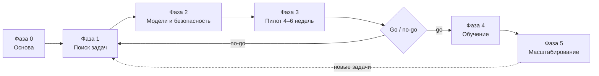

# Плейбук внедрения ИИ в компании

> Практический шаблон: от договорённостей со спонсором до масштабирования и управления. Не заменяет юридическую и финансовую консультацию — см. раздел 10.

## 0. Для кого этот документ и как им пользоваться

Документ написан для специалиста по внедрению ИИ — штатного или внешнего, — который отвечает за результат проекта, а не только за выбор нейросети. Идите по фазам сверху вниз: у каждой есть проверяемый результат и конкретные инструменты **AI Adoption Compass** — команды `compass`, веб-интерфейс (`compass serve`) и MCP-сервер (`compass mcp`). Чтобы увидеть форматы результатов, запустите `compass demo`: он разбирает вымышленную компанию «ООО «Ромашка-Сервис»» с 18 процессами. Числа в шаблонах — стартовые значения для настройки, а не отраслевая статистика: подставляйте свои замеры.



| Фаза | Результат | Что использовать в Compass |
| --- | --- | --- |
| 0. Основа | Цели, спонсор, политика данных, роли | `compass policy handout`, раздел «Безопасность данных» |
| 1. Поиск задач | Ранжированный список процессов, 2–3 кандидата в пилот | `compass assess`, раздел «Оценка процессов» |
| 2. Модели и безопасность | Выбранные модели и поставщики, правила работы с данными | `compass advise`, `compass scan`, `compass mask`, раздел «Подбор моделей» |
| 3. Пилот | Решение go / no-go на фактах | `compass eval`, раздел «Качество моделей» |
| 4. Обучение | Сотрудники работают по правилам, есть библиотека промптов | `compass prompt`, раздел «Промпты», [план тренинга](training/workshop-plan.md) |
| 5. Масштабирование | Управление, бюджеты, реестр задач | `compass catalog check`, раздел «Журнал», `compass mcp` |

## 1. Фаза 0 — Основа

### Что решить до первого запроса к модели

Модели на этом этапе не выбираем и данные не отправляем: сначала договорённости.

- [ ] Назначен спонсор с бюджетом и правом принимать решения; цель измерима (одна–две метрики и срок).
- [ ] Определены границы: какие процессы и данные на первом этапе не трогаем.
- [ ] Утверждена политика данных: классы данных и допустимые размещения моделей.
- [ ] Есть список разрешённых сервисов и корпоративных аккаунтов; личные аккаунты для рабочих данных запрещены.
- [ ] Назначены ответственные за информационную безопасность и за разбор инцидентов.
- [ ] Согласованы потолок расходов на пилот (подписки, API, время сотрудников) и ответственный за замер базовых показателей до старта.

### Роли и ответственность (RACI)

R — выполняет, A — отвечает и принимает решение (один на строку), C — консультирует, I — информируется.

| Задача | Спонсор | Руководитель проекта (ИИ-специалист) | ИТ / ИБ | Юрист | Владельцы процессов | HR / обучение |
| --- | --- | --- | --- | --- | --- | --- |
| Цели, бюджет, KPI | A | R | C | I | C | I |
| Политика данных | A | R | R | C | C | I |
| Список и оценка процессов | I | A, R | C | I | R | I |
| Выбор моделей и поставщиков | C | A, R | R | C | I | — |
| Договоры с поставщиками | I | R | C | A | — | — |
| Пилот: запуск и ведение | I | A, R | C | I | R | I |
| Решение go / no-go | A | R | C | C | C | I |
| Обучение сотрудников | I | R | C | I | C | A |
| Реагирование на инциденты | I | R | A | C | I | I |

### Политика данных

Матрица по умолчанию (файл `policy.yaml`) — стартовая точка, а не готовое решение:

| Класс данных | Российское облако | Зарубежное облако | Свой контур (self-hosted) |
| --- | --- | --- | --- |
| Публичные | ✅ можно | ✅ можно | ✅ можно |
| Внутренние | ✅ можно | 🟡 после обезличивания | ✅ можно |
| Конфиденциальные | 🟡 после обезличивания | ⛔ нельзя | ✅ можно |
| Персональные | 🟡 после обезличивания | ⛔ нельзя | ✅ можно |

Секреты — ключи, токены, пароли — не отправляются никуда. Свою версию политики сделайте так: `compass data export ./my-data`, поправьте `policy.yaml` и укажите каталог в переменной `COMPASS_DATA_DIR` — файлы оттуда заменяют встроенные (так же настраиваются `catalog.yaml`, `scoring.yaml` и `prompts.yaml`).

> [!IMPORTANT]
> Закон о персональных данных (152-ФЗ) устанавливает отдельные требования к обработке персональных данных и к локализации баз данных с данными граждан РФ, а также ограничивает решения о людях, принимаемые только автоматизированно. Как это применяется к вашим процессам, определяет юрист: согласуйте с юристом и ИБ классы данных и матрицу.

Памятку для сотрудников собирайте из той же политики, чтобы правила для людей и для инструментов не расходились: командой ниже или кнопкой «Скачать памятку (.md)» на вкладке «Политика» раздела «Безопасность данных». Готовый пример — [safe-ai-handout.md](training/safe-ai-handout.md); раздайте памятку до старта пилота:

```bash
compass policy handout -o handout.md
```

## 2. Фаза 1 — Поиск задач

### Интервью и воркшопы

1. Встреча на 60–90 минут с владельцем процесса и одним–двумя исполнителями. Разбирайте процесс по шагам — от входа до результата, а не «где бы применить ИИ».
2. Пять вопросов: что именно вы делаете; сколько раз в месяц и сколько минут на один раз (покажите три последних случая); где чаще всего ошибки и во что обходится одна; какие данные видите по ходу работы; что должно остаться за человеком.
3. Проверьте слова наблюдением: засеките время на 5–10 реальных случаях и сверьте объём с системой (CRM, helpdesk, учётная система). Записывайте источник каждой цифры — замер, выгрузка или оценка по памяти.

### Как заполнить CSV

Обязательны только `name`, `task_type`, `runs_per_month` и `minutes_per_run`. Остальное можно пропустить, но каждое пустое поле — допущение: подставятся значения по умолчанию (доля ошибок 5%, стандартизация и цифровая готовность — 3, риск — 2, класс данных — «внутренние»). Заголовки могут быть русскими, разделитель — `,`, `;` или табуляция, кодировка — UTF-8 или cp1251 (так сохраняет Excel). Образец — кнопка «Скачать шаблон CSV» в разделе «Оценка процессов» (файл `src/adoption_compass/data/samples/processes.csv`). Честность важнее красоты: если цифра неизвестна, оставьте поле пустым или поставьте осторожную оценку и пометьте источник — пилот всё равно проверит её, а завышенный эффект подорвёт доверие спонсора.

| Колонка | Как получить | Типичная ошибка |
| --- | --- | --- |
| `runs_per_month` | Выгрузка из системы за 3 месяца, среднее | Берут пиковый месяц или цифру «по ощущениям» |
| `minutes_per_run` | Замер на 5–10 случаях, медиана; включайте поиск данных и переключения | Считают только «чистую» работу |
| `hourly_cost_rub` | Полная стоимость часа (зарплата, взносы, накладные) у финансистов или HR; пусто — берётся значение `--hourly` | Делят оклад на 160 часов, забыв про взносы и накладные |
| `error_rate`, `error_cost_rub` | Журналы возвратов, рекламаций, переделок; в стоимость — прямые потери и время на исправление | Завышают стоимость ошибки «на всякий случай» |
| `standardization`, `digital_readiness` (1–5) | Стандартизация: 1 — каждый случай уникален, 5 — строгий шаблон. Готовность: 1 — бумага и устные договорённости, 5 — структурированные данные с API. Смотрите 10 случаев | Оценивают по регламенту, а не по реальной работе; считают «цифровым» скан без распознавания |
| `risk_level` (1–5) | Цена ошибки: 1 — незаметна, 5 — юридические и финансовые последствия или вред людям | Занижают риск, чтобы процесс попал в пилот |
| `data_sensitivity`, `must_self_host` | Класс по политике данных; `yes`, если по требованию ИБ или договора данные не должны покидать контур | Выбирают класс «на глаз», не открыв реальные документы |

### Запуск оценки и чтение результата

```bash
compass assess processes.csv -f md -o assessment.md --horizon 12 --hourly 800
```

В веб-интерфейсе то же делает раздел «Оценка процессов»: загрузите CSV, получите квадранты и дорожную карту, выгрузите отчёт и таблицу. Инструмент считает экономию времени и ошибок за вычетом расходов на модель, внедрение и сопровождение в трёх сценариях — пессимистичном, базовом и оптимистичном — и подбирает модель под политику данных. Допущения (горизонт, стоимость дня внедрения, курс) лежат в `scoring.yaml` и настраиваются под компанию: показывайте их спонсору вместе с результатом.

| Квадрант | Что значит | Что делать |
| --- | --- | --- |
| «Быстрая победа» (волна 1) | Высокий эффект, просто внедрить | Кандидаты в пилот |
| «Стратегический проект» (волна 2) | Большой эффект, но сложно или дорого | Отдельный проект после первых побед; сначала проверьте допущения |
| «Попутная задача» (волна 3) | Просто, но эффект невелик | Закрывайте шаблонами промптов и обучением, а не проектом |
| «Отложить» | Не окупается при текущих допущениях | Вернитесь через квартал или пересмотрите допущения |
| «Нет допустимой модели» | Ни одна модель не проходит политику данных и требование к качеству | Self-hosted, другая постановка задачи или оставить человеку |

**Красные флаги:**

- **«Нет допустимой модели»** — не обходите политику данных: это результат расчёта, а не его ошибка.
- **Цифровая готовность 1–2** — сначала оцифровка (распознавание, интеграции); инструмент закладывает её в сроки, но риск проекта растёт.
- **Риск 4–5 или поддержка принятия решений** — человек проверяет каждый результат, а требуемое качество модели выше.
- **Решения о людях** (найм, увольнение, кредит) по ответу модели — критический риск; закон ограничивает автоматизированные решения о людях — согласуйте с юристом.
- **Эффект есть только в оптимистичном сценарии** — пилот должен проверить именно то допущение, от которого он зависит.

**Как выбрать 2–3 пилота:**

- [ ] Процессы из «быстрых побед», по возможности из разных подразделений.
- [ ] У каждого есть заинтересованный владелец и исполнители, готовые вести замеры; базовые показатели можно снять за неделю.
- [ ] Риск не выше 3, нет автоматических решений о людях; результат можно сравнить с ручной работой на том же наборе случаев.
- [ ] Решено и заранее объявлено людям, на что пойдёт высвободившееся время: без этого пилот встретит сопротивление.

## 3. Фаза 2 — Подбор моделей и безопасность

### Подбор: `compass advise`

```bash
compass advise --task classification --requests 9500 --tokens-in 700 --tokens-out 60 \
  --sensitivity personal --min-quality 4 --show-excluded
```

Сначала применяются жёсткие ограничения: политика данных (ни один флаг её не ослабляет), `--self-host`, доступ из РФ, минимальное качество, `--budget` (₽ в месяц), `--vision` и `--tools`. Оставшиеся модели ранжируются по качеству, стоимости, безопасности размещения и доступности; акцент задаёт `--prefer balanced`, `cost`, `quality` или `safety`. `--show-excluded` объясняет, почему модель отпала, — используйте это в разговоре со спонсором и ИБ.

### Доступ из России и размещение данных

- По умолчанию исключены модели, доступные из РФ только через обходные пути (посредники, зарубежная оплата); `--workarounds` возвращает их с предупреждением. Не стройте на них процесс: блокировка аккаунта или платежа его остановит, а нарушение условий использования — риск для компании. Доступность и условия меняются — перед решением проверяйте актуальное состояние у поставщика и в ИТ.
- Российское облако упрощает выполнение требований о локализации персональных данных; зарубежное обрабатывает данные за рубежом; self-hosted оставляет их в вашем контуре. Трансграничная передача и локализация баз персональных данных регулируются законом — согласуйте с юристом.

### Обезличивание

```bash
compass mask letter.txt --mapping map.json -o letter.masked.txt   # ФИО, телефон → [PERSON_1], [PHONE_1]
compass unmask reply.txt --mapping map.json -o reply.final.txt    # вернуть значения в ответе модели
```

Это обратимая замена на метки (псевдонимизация): файл `map.json` содержит исходные данные, хранится только у вас и не передаётся в сервисы. Пока он существует, данные можно восстановить — как это трактуется юридически, согласуйте с юристом. Проверка ищет шаблоны (телефоны, e-mail, ИНН, СНИЛС, паспорта, карты, адреса, ФИО с отчеством, ключи и пароли); коммерческую тайну и имя с фамилией без отчества она может не увидеть, поэтому читайте текст глазами.

### Self-hosted или облако

| | Облако (российское или зарубежное) | Self-hosted |
| --- | --- | --- |
| Расходы | За токены: растут вместе с объёмом | Фиксированная плата за блоки мощности плюс сопровождение; выгодно при большом стабильном объёме |
| Данные | Уходят к поставщику, действуют условия договора | Остаются в вашем контуре |
| Команда и старт | Достаточно интеграции, запуск быстрый | Нужны люди (развёртывание, обновления, безопасность) и время на настройку |

Считайте точку безубыточности: фиксированные расходы в месяц ÷ экономия на одном запросе по сравнению с облаком — это число запросов в месяц, с которого self-hosted выгоднее. Если данные нельзя выпускать из контура, self-hosted — единственный вариант, но качество на вашей задаче проверьте заранее (`compass eval`).

### Что проверить в договоре с поставщиком

- [ ] **Хранение:** срок хранения запросов и ответов, можно ли отключить хранение, как удаляются данные по запросу.
- [ ] **Обучение:** используются ли ваши данные для обучения моделей поставщика и как это отключить.
- [ ] **Размещение:** в какой стране обрабатываются и хранятся данные, есть ли субподрядчики; роль поставщика при обработке персональных данных — согласуйте с юристом.
- [ ] **Безопасность:** шифрование, разграничение доступа, журналы, сроки уведомления об инцидентах.
- [ ] **SLA:** доступность, время реакции поддержки, лимиты запросов и что происходит при их превышении.
- [ ] **Оплата и изменения:** валюта, способ оплаты, закрывающие документы, за сколько дней предупреждают об изменении тарифов, условий и снятии моделей с поддержки.
- [ ] **Выход:** как выгрузить данные и настройки, срок удаления после расторжения.
- [ ] **Ответственность:** её пределы и права на результаты генерации.

Тарифы проверяйте сами. Каталог моделей в Compass демонстрационный (`data_status: illustrative`): перед решением сверьте цены и условия с официальными страницами поставщиков, обновите `reviewed_at` и переключите статус на `verified` в своей копии `catalog.yaml`.

## 4. Фаза 3 — Пилот (4–6 недель)

### Хартия пилота

Заполните и подпишите до старта. Пример на данных «Ромашка-Сервис» (процесс P01 из демо-файла; у вас будут свои замеры):

| Поле | Пример |
| --- | --- |
| Процесс, владелец | Маршрутизация обращений клиентов; руководитель поддержки |
| Цель | Сократить время ручной маршрутизации и долю ошибок без потери качества |
| Границы, данные | Одна очередь обращений; ИИ предлагает категорию и приоритет, клиентам не отвечает; персональные данные — российское облако после обезличивания или self-hosted |
| Базовые показатели | Время на обращение — 3 мин, ошибочная маршрутизация — 8% (замер на выборке, источник записан) |
| Критерии успеха | Пороги из рубрики go / no-go ниже, согласованные со спонсором |
| Критерии остановки | Любой инцидент с данными; качество ниже порога две недели подряд; рост жалоб клиентов из-за маршрутизации |
| Команда и сроки | Владелец процесса, ИИ-специалист, ИТ / ИБ, 3–5 исполнителей; 5 недель |
| Решение | Дата и ответственный (спонсор) |

### Ритм по неделям

| Неделя | Режим | Что делаем |
| --- | --- | --- |
| 0 | Подготовка | Базовые показатели, эталонный набор, доступы, инструктаж, проверка `compass scan` на учебных данных |
| 1 | «Тень» | ИИ готовит результат параллельно, сотрудник работает как обычно; сравниваем |
| 2–3 | Человек в контуре | Сотрудник проверяет и правит результат ИИ; фиксируем правки и причины, дорабатываем промпт |
| 4 | Расширение | Больше исполнителей и объёма, повторный замер времени |
| 5–6 | Стабилизация | Оценка на новом наборе, подсчёт эффекта и расходов, решение go / no-go |

Раз в неделю — 30 минут: метрики, пять разобранных ошибок, инциденты, решения. Итог — заметка на страницу.

### Правила «человека в контуре»

1. Риск 4–5 и поддержка решений — проверяется каждый результат.
2. Всё, что уходит клиентам и в документы, проверяет человек до отправки.
3. Решения о людях (найм, увольнение, кредит) модель не принимает — только готовит материалы.
4. Ответственность за результат остаётся на сотруднике, а не на «нейросети».
5. Долю проверок снижайте по порогам качества и только по решению владельца процесса.

### Эталонный набор (golden dataset)

1. Возьмите реальные случаи за последние месяцы, обезличьте (`compass mask`) и проверьте `compass scan`.
2. Соберите 50–100 примеров: пропорции как в реальном потоке плюс трудные случаи (редкие, двусмысленные, с опечатками).
3. Разметьте двумя людьми независимо, расхождения разберёт владелец процесса.
4. Отложите часть примеров (например, каждый пятый) как «скрытый» набор и не показывайте их при настройке промптов.
5. Формат — JSONL, по строке на пример: `{"id": "1", "text": "Списали деньги дважды за один заказ", "label": "billing"}`; версионируйте набор вместе с промптами.

```bash
compass eval run -p baseline -p api --dataset golden.jsonl \
  --base-url "$LLM_BASE_URL" --model "$LLM_MODEL" --api-key-env LLM_API_KEY \
  --price-in "$PRICE_IN" --price-out "$PRICE_OUT" -f md -o eval-report.md
```

`compass eval` работает с любым OpenAI-совместимым API; цены (₽ за 1 млн токенов) берите из актуального тарифа или записи каталога (`--catalog-id`). Отчёт показывает точность, F1, число невалидных ответов, задержку p50 и p95, стоимость и прирост к простым правилам (`baseline`): если модель не лучше правил на ваших данных, она не нужна. Сейчас инструмент рассчитан на классификацию с фиксированным набором категорий (по умолчанию — маршрутизация обращений); свои категории задайте файлами `evals/routing.yaml` и `evals/routing.jsonl` в каталоге `COMPASS_DATA_DIR` (заготовку даёт `compass data export`), для других типов задач применяйте ту же методику вручную. `compass eval demo` — офлайн-симуляция механики, а не сравнение реальных моделей.

### Рубрика go / no-go

Пороги — примеры: владелец процесса задаёт свои, исходя из цены ошибки.

| Критерий | Как измеряем | Порог (пример) | Тип |
| --- | --- | --- | --- |
| Качество | Точность и F1 на скрытом наборе | Не ниже порога владельца процесса, например 90% при проверке человеком | Обязательный |
| Прирост к правилам | Δ baseline, п. п. | Например, не менее +10 п. п. | Обязательный |
| Данные и безопасность | Инциденты, срабатывания `compass scan` | 0 инцидентов; все запросы через разрешённые сервисы | Обязательный |
| Экономика | Факт против сценариев `compass assess`; стоимость задачи | Эффект не ниже пессимистичного сценария, расходы в бюджете пилота | Обязательный |
| Надёжность | Невалидные ответы, доступность, задержка p95 | Например, невалидных не более 2%; задержка укладывается в процесс | Обязательный |
| Принятие командой | Использование и опрос | Например, еженедельно пользуется 70% участников, оценка не ниже 4 из 5 | Желательный |

**Go** — выполнены все обязательные критерии. **Go с условиями** — не выполнены желательные: план на 2–4 недели с владельцем и сроком. **No-go** — не выполнен обязательный критерий или сработал стоп-критерий: вернитесь к фазе 1 или 2 (другая задача, модель или постановка).

## 5. Фаза 4 — Обучение сотрудников

Формат — двухчасовой практикум на синтетических данных, затем повторения через 2 и 6 недель: [план тренинга](training/workshop-plan.md) и [памятка](training/safe-ai-handout.md).

**Библиотека промптов.** Из коробки — 12 шаблонов: `meeting-summary`, `customer-reply`, `ticket-triage`, `invoice-extraction`, `kb-answer`, `contract-risk-review`, `weekly-report`, `translate-glossary`, `sql-helper`, `job-description`, `product-card`, `review-reply`. Список — `compass prompt list`, чек-лист проверки ответа — `compass prompt show customer-reply`.

| Правило | Как работает |
| --- | --- |
| Владелец | У каждого шаблона владелец из подразделения; за библиотеку в целом отвечает ИИ-специалист или чемпион |
| Версии и ревью | Шаблоны (`prompts.yaml`) лежат в git, изменения — через pull request с пояснением; второй человек проверяет, `compass prompt lint FILE --min-score 85` — условие добавления |
| Безопасность | У шаблона указан класс данных, есть `checklist` проверки ответа и `safety_notes`; примеры проходят `compass scan` |
| Пересмотр | Раз в квартал: что используют, что устарело; шаблоны без владельца удаляются |

**Сеть чемпионов.** Чемпион — сотрудник подразделения, не обязательно технарь: волонтёр или назначенный руководителем.

- Задачи: первая линия помощи коллегам, сбор идей и ошибок, еженедельные часы консультаций, ежемесячная встреча чемпионов на 45 минут.
- Время чемпиона закладывается в план: без этого сеть перестаёт работать через пару месяцев.

## 6. Фаза 5 — Масштабирование и управление

### Совет по ИИ и приём новых задач

**Совет по ИИ (governance board):** спонсор, ИИ-специалист, ИТ / ИБ, юрист, 1–2 владельца процессов, представитель HR; раз в месяц, 45–60 минут. Решает по новым задачам и поставщикам, изменениям политики, бюджетам и инцидентам; ведёт реестр: задача, владелец, класс данных, модель и поставщик, метрики, статус. Статистику проверок и оценок берите из раздела «Журнал»: там только метаданные (число символов, типы находок, решения), без текстов.

Приём новых задач (intake):

1. Заявка на одной странице: процесс, владелец, класс данных, объём, ожидаемый эффект, что остаётся за человеком.
2. Быстрый скрининг ИБ и юриста: класс данных и допустимое размещение (`compass scan` на примерах).
3. Оценка: строка в CSV и `compass assess` — квадрант и красные флаги.
4. Решение совета (пилот, очередь или отказ с причиной) и запись в реестре.

### Автоматические проверки: каталог, данные, агенты

```bash
compass catalog check --max-age-days 90 --strict   # код 1, если есть устаревшие записи
compass scan prompts/new-template.txt --target foreign_cloud --fail-on deny   # код 2 — отправка не разрешена
```

Первую команду поставьте в расписание CI — в репозитории Compass это уже сделано (`.github/workflows/catalog-freshness.yml`: раз в месяц, при устаревании заводит issue); при срабатывании сверьте тарифы с официальными страницами, обновите `reviewed_at`, перезапустите `compass assess` и прогоните `compass eval` по альтернативным моделям. Вторая подходит для CI и pre-commit: `--fail-on mask` блокирует и случаи, где нужно обезличивание, `--fail-on never` только сообщает результат. Разработчикам и аналитикам с ИИ-агентами (Claude Code, Codex, OpenCode, Kiro) подключите `compass mcp --root ./work`: агент сможет оценивать задачи и проверять файлы на персональные данные и секреты до отправки.

### Инциденты с данными

1. Сотрудник сообщает ИБ в течение рабочего дня. Заранее закрепите: за честное и своевременное сообщение не наказывают — иначе о проблемах перестанут говорить.
2. Остановить отправку, отозвать доступы, немедленно перевыпустить ключи и пароли; зафиксировать, что и куда ушло, историю диалога не удалять до разбора.
3. Оценить последствия: класс данных, размещение, число людей, чьи данные затронуты.
4. Решить, нужны ли уведомления поставщика, регулятора и людей, чьи данные затронуты, — согласуйте с юристом.
5. Разобрать причину, обновить политику, обучение и проверки (например, добавить `compass scan` в CI), доложить совету.

### Расходы и зависимость от поставщика

- Бюджеты по командам и задачам, оповещения при достижении порогов; токены учитывайте на уровне задачи.
- Кэшируйте повторяющиеся запросы на своей стороне; ограничивайте длину входа и ответа.
- Маршрутизируйте: простые задачи — на экономичные модели, сложные — на сильные; таблицу «процесс → модель» берите из `compass assess`, а качество перепроверяйте на эталонном наборе.
- Считайте полную стоимость задачи: токены, инфраструктура, сопровождение, время проверки; курс валюты и тарифы пересматривайте вместе с каталогом.
- Храните промпты, эталонные наборы и отчёты оценки у себя, а не в интерфейсе сервиса; предпочитайте поставщиков с совместимым интерфейсом (`compass eval` работает с любым OpenAI-совместимым API) — проверьте это в их документации.
- Держите резервную модель и раз в квартал прогоняйте на ней эталонный набор; закрепите в договоре порядок выхода и выгрузки данных.

## 7. Метрики успеха

Базовые значения фиксируйте до старта, отчитывайтесь раз в месяц одним слайдом: показатели из таблицы, три разобранных примера ошибок, у каждой цифры — источник.

| Метрика | Как измерять | Типичная ловушка |
| --- | --- | --- |
| Использование | Доля сотрудников целевой группы, работающих с одобренными инструментами еженедельно: данные поставщика или опрос раз в месяц | Считают выданные аккаунты, а не реальное использование |
| Сэкономленное время | Минуты на операцию до и после по одной методике × объём, за вычетом времени проверки; факт против прогноза `compass assess` | Переводят «часы» в рубли, не решив, на что они пойдут; сравнивают с оптимистичным сценарием |
| Качество | Точность и F1 на скрытом наборе (`compass eval`), доля правок человеком, жалобы и переделки | Оценивают на тех же примерах, на которых настраивали промпт |
| Стоимость задачи | (токены + подписки + инфраструктура + сопровождение + время проверки) ÷ число задач | Учитывают только счёт за API |
| Инциденты | Число инцидентов и «почти-инцидентов» (сообщения в ИБ, блокировки `compass scan`), время реакции | «Ноль инцидентов» там, где о них боятся сообщать |
| Удовлетворённость | Опрос из 3–5 вопросов раз в месяц, оценка 1–5 и комментарии | Опрашивают только энтузиастов |

## 8. Риски и антипаттерны

| Риск | Как проявляется | Что делать |
| --- | --- | --- |
| Теневой ИИ | Личные аккаунты и бесплатные сервисы для рабочих данных | Дать разрешённый сервис раньше, чем люди найдут свой; памятка, обучение, понятные правила |
| Слепое доверие к ответам | Ответы уходят клиентам и в документы без проверки | Чек-листы в шаблонах, обязательная проверка по уровню риска, разбор ошибок на обучении |
| Пилот без базового уровня | «Стало лучше», но измерить нечем | Замеры до старта — условие запуска пилота |
| Игнорирование политики данных | Персональные данные в зарубежных сервисах, ключи в запросах | Политика, `compass scan` в CI, техническое ограничение доступа |
| Инструмент вместо задачи (tool-first) | Купили подписки, а применение ищут потом | Идти от `compass assess`, а не от списка сервисов |
| Задачи из хайпа | В работе то, что модно, а не то, что окупается | Приём новых задач через оценку; «Отложить» — тоже результат |
| Нет владельца и срока (вечный пилот) | Пилот «ничей», тянется месяцами, после ухода энтузиаста встаёт | Владелец процесса и владелец решения в реестре; срок и критерии go / no-go в хартии |
| Зависимость от одного поставщика | Блокировка аккаунта, смена тарифа или недоступность из РФ останавливают процесс | Резервная модель, эталонный набор, выход в договоре |
| Скрытые расходы | Бюджет растёт из-за длинных запросов, повторов и лишних подписок | Бюджеты и оповещения, кэш, маршрутизация, пересмотр каталога |
| Разовое обучение | Через месяц все вернулись к старым привычкам | Повторения через 2 и 6 недель, чемпионы, библиотека промптов |

## 9. Чек-лист «готовы ли мы масштабировать?»

Ответьте «да» или «нет». «Нет» в пунктах 1–6 — остановитесь и закройте пробел; «нет» в пунктах 7–10 — зафиксируйте план и срок.

- [ ] 1. Есть спонсор и утверждённый бюджет на масштабирование.
- [ ] 2. Политика данных утверждена ИБ и юристом, сотрудники с ней знакомы.
- [ ] 3. Пилот завершён решением go по заранее заданным критериям.
- [ ] 4. Эффект подтверждён фактом и не хуже пессимистичного сценария.
- [ ] 5. У каждой задачи в эксплуатации есть владелец и человек, проверяющий результат.
- [ ] 6. Процесс реагирования на инциденты с данными описан и разобран на учебном сценарии.
- [ ] 7. У библиотеки промптов есть владельцы, версии и ревью; сотрудники обучены, в подразделениях есть чемпионы.
- [ ] 8. Расходы управляются: бюджеты, оповещения, стоимость задачи в отчётности.
- [ ] 9. Есть резервная модель, качество на эталонном наборе проверено; каталог тарифов пересмотрен за последние 90 дней.
- [ ] 10. Совет по ИИ собирается регулярно и ведёт реестр задач.

## 10. Дисклеймер

Документ — практический шаблон, а не юридическая, финансовая или консультация по информационной безопасности. Упоминания закона о персональных данных (152-ФЗ), локализации баз данных, трансграничной передачи и автоматизированных решений даны в общем виде: согласуйте с юристом. Расчёты Compass опираются на допущения и демонстрационные данные каталога: перед решениями проверяйте тарифы и условия поставщиков и тестируйте качество на своих данных.
